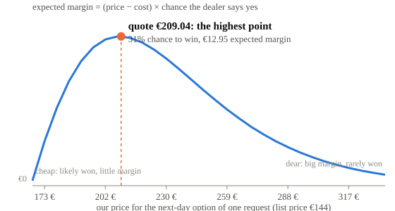
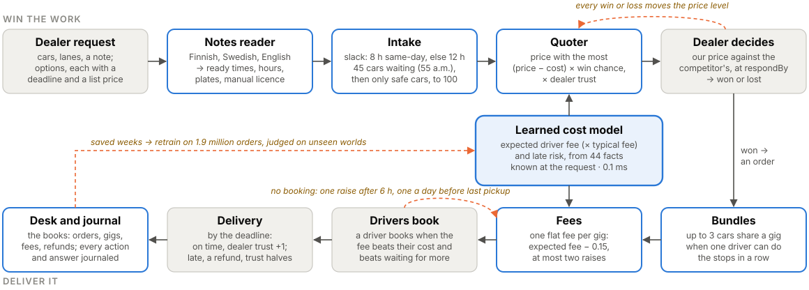

title: pelaaja juhlii · Spread dispatcher

<!--
The deck's source. Build: python3 docs/deck/build.py (see README.md).
Numbers: the with/without runs of 15 Nov (tracks/t1, t2, t3/ablation-20261115.md) and tracks/orch/FINDINGS.md.
-->

<!-- slide: title -->
::: kicker
pelaaja juhlii · Spread · Junction 2026
:::

# We price each car over its own learned cost, and take only the work our drivers can deliver

::: tiles fill
- **Final: 7th of 58 ranked teams** €19,863 margin · 422 orders · 96.7% on time
:::

### Our big ideas

::: ideas
1. **Learn what each car will cost.** A machine learning model, trained on every week we played, predicts the driver fee and the late risk.
2. **Quote for the most expected margin.** Each price weighs our margin against the chance the dealer says yes.
3. **One flat fee for drivers.** A gig opens near what the car needs and rarely rises, so drivers have no reason to wait.
4. **Take only work we can staff, and share drivers.** When drivers are short we take only easy cars; one driver carries two or three.
5. **Measure every idea.** Each is a switch, played with and without on the same weeks before it is kept.
:::

---

::: kicker
Idea 1 · What a car will cost
:::

# A machine learning model predicts the driver fee each car will need

::: cols c46
### The idea
From the first practice week we saved every request, decision and result: 1.9 million orders. On them we trained a model that predicts, for each request, the driver fee we will have to pay (as a coefficient of its typical fee) and the car's chance of being late.

### Why
Before the model, our hand-fit formula expected won cars to cost 1.19 × their typical fee; the ledger said 0.92 ×. So before the model we quoted far above what the cars really cost us, and lost requests we should have won.
+++
| Error on worlds it never trained on | fee error (× typical) | late log loss |
|---|---:|---:|
| no model: one constant | 0.309 | 0.133 |
| our hand-fit formula | 0.274 | 0.121 |
| **machine learning model** | **0.232** | **0.101** |

::: effect
**+19% margin** with the model instead of the hand-fit formula, on the same 10 weeks (ahead in all 10); **360 → 401** orders a week; weakest week **93.4% → 95.5%** on time.
:::
:::

---

::: kicker
Idea 2 · Prices
:::

# Each quote is the price with the most expected margin

::: cols c46
### The idea
For each delivery option we try every price from the car's cost upward and quote the one at the top of the curve. The chance to win follows one learned price level: up after every win, down after every loss. Dealers who got their cars on time from us accept a little more.

The cost is the model's fee with a safety margin: 10% on top, or 15% off for trips under 100 km, where the model ran high.

### Why
The price dealers accept moved between 1.10 and 1.67 × list from day to day: one number that follows our wins and losses keeps up with it.
+++

::: effect
- **+50% margin** with this quote instead of a fixed markup over list, same 10 weeks, ahead in all 10. Without it one week fell to 87.1% on time and out of the ranking.
- **Offer the dealer same-day delivery whenever a driver still has 8 hours to make it** (before: 12 hours): a request with both same-day and next-day is won 67% of the time, next-day alone 34%. **+16% margin**, 332 → 401 orders a week.
:::
:::

---

::: kicker
Idea 3 · Drivers and fees
:::

# A gig opens at one flat fee and rarely rises

::: cols c55
### The idea
Drivers learn our fees: if they expect a raise, they wait for it. So a gig opens at **(expected fee − 0.15) × typical fee**, the expected fee coming from the machine learning model, and holds it. It never opens below 0.75 × typical (0.95 for a very short trip or a car with little time left).

It rises by 0.15 × typical at most twice: after 6 daytime hours (07–21) without a booking, and a day before the last pickup. Close to the deadline, an urgent fee takes over.

### Why
With a fee that rose every hour, drivers saw the gig, waited for the next raise, and booked late and at a higher fee.
+++
::: tiles stack
- **86 min → 7–12 min** median time from posting to booking for a one-car gig
- **7.0% → about 5.9%** of one-car gigs late
- **+18% margin** with flat fees instead of the hourly rising fee, same 10 weeks, ahead in all 10
:::
:::

---

::: kicker
Idea 4 · Which cars, and how many per driver
:::

# We take only the cars we can staff, and let one driver carry two or three

::: cols c55
### What breaks when we take more

We tried taking 55% more orders to see what breaks: margin fell 19%. Long trips and private addresses went late; short, ordinary cars stayed on time.
+++
### Easy cars when drivers are short
If we don't think we can get a driver, we don't take the car. When many of our cars are still waiting for a driver, we keep quoting only the cars that are easy to staff.

### Bundles
A new car joins a gig no driver has booked yet when one driver can do the stops in a row, up to 3 cars. The gig pays 0.85 × the cars' fees together, so each car costs less.

::: effect
- Bundles: **+27% margin**, 359 → 401 orders a week. In a two-car gig a car costs 0.79 × typical and is 1.0% late; alone 0.97 × and 3.7%.
- Easy cars only when drivers are short: **+2% margin**, 390 → 401 orders a week.
:::
:::

---

# How the ideas work together

---

::: kicker
The effect of each idea
:::

# Switch any one idea off and the same 10 weeks earn less

::: ablation
| Idea switched off | Margin, 10 weeks | The idea adds | Orders a week | On time, mean / weakest | Full system wins |
|---|---:|---:|---:|---:|---:|
| **None off: all ideas in use** | **€177,043** | | **401** | **97.2% / 95.5%** | |
| Idea 2 · Expected-margin quote | €118,016 | **+50%** | 259 | 93.0% / 87.1% ✗ | 10 of 10 |
| Idea 4 · Bundles | €138,985 | **+27%** | 359 | 96.8% / 94.5% | 10 of 10 |
| Idea 1 · Machine learning cost model | €148,742 | **+19%** | 360 | 94.9% / 93.4% | 10 of 10 |
| Idea 3 · Flat fees | €150,450 | **+18%** | 403 | 96.8% / 95.6% | 10 of 10 |
| Idea 2 · Same-day offers | €152,203 | **+16%** | 332 | 97.5% / 95.9% | 10 of 10 |
| Idea 2 · Safety margin on the cost | €168,296 | **+5%** | 398 | 95.6% / 92.8% | 9 of 10 |
| Idea 2 · Dealer trust | €171,617 | **+3%** | 413 | 96.6% / 95.2% | 8 of 10 |
| Idea 4 · Easy cars when drivers are short | €173,827 | **+2%** | 390 | 96.6% / 94.9% | 7 of 10 |
:::

::: note
The final's exact code, one idea switched off per row, on the same 10 weeks, played on the morning of the final. ✗ marks a week under 90% on time, which does not rank. The limit on how many cars may wait for a driver is not listed: it adds no margin, but without it the weakest week falls from 95.5% to 92.7%, close to the 90% line.
:::

---

::: kicker
The Saturday 20:00 test final
:::

# How our strategy differs from others

::: cols c55

+++
### A selective desk
Every team played the same week. We finished 5th of 75 ranked teams with fewer orders than the teams around us (356 against 440–500), but the highest margin per order of the top five: €49 against €36–42, and the largest share of revenue kept as margin, 41%.

### Why
We price every car over its own predicted cost and stay out of the price fight for cars that would cost more than they pay. The teams above us won volume on short, cheap trips; we won the middle distances, where our cost estimate is sharp.

::: effect
**What we took from it:** the short trips we lost cost us too much to staff, not too little to win. A lower opening fee for them and a cheaper cost for trips under 100 km won more of them without giving up the rule.
:::
:::

---

::: kicker
Robust
:::

# It holds on weeks it has never seen

::: cols c64

**40 weeks the final's code never saw:** all ranked, mean 96.1% on time, weakest 92.4%, €17,308 and 399 orders a week. **Best ranking round,** with the final's exact code: 8th of 52 ranked teams, all 5 weeks ranked, 96.6% on time.
+++
### How an idea gets in
1. **See it** in the live leaderboard, our books or a study of saved weeks.
2. **Build it as a switch**, off by default: with the switch off the code must give the old result to the cent.
3. **Try it** on the 10 development weeks, both versions on the same worlds.
4. **Check it** on 30 weeks it was never tuned on: total margin must rise and no week may come near 90% on time.
5. **Adopt it.** The next idea is measured against the new mainline.
:::

---

::: kicker
Limits and next steps
:::

# What did not work, what would break it, what we would do next

::: cols c333 limits
## Did not work
- **Holding fees back:** unbooked gigs filled our queue and cost margin.
- **Direct offers to drivers:** 91 of 3,783 accepted.
- **Cheaper quotes for volume:** each extra order cost more margin than it brought.
- **Bundles of 4 or 5 cars:** lost margin against 3.

## We don't know
- How much of the model's skill comes from our own books, which change when the policy changes.
+++
## Would break it
- **Far fewer or pickier drivers:** flat fees would sit unbooked and the urgent fees would eat the margin.
- **A competitor that undercuts for days:** our quote stops at the car's cost; on the one price-war day we won 23% of requests against 32–48%.
- **Dealer prices that jump within a day:** one price level follows them only step by step.
- **A world unlike the ones we trained on:** the fee estimates, and the quotes with them, would be off.
+++
## What we would do next
- **Retrain on real bookings** and keep judging every model on weeks it never saw.
- **Learn each dealer's own price level**, not one for the whole market.
- **Forecast free drivers** near each pickup and price that supply into the quote.
- **Plan bundles ahead** across the day instead of as cars arrive.
:::

::: note
**Try the demo at spread.langsjo.dev:** Replay a real week on the map, then open any request and follow its decision through every part, with the numbers.
:::
