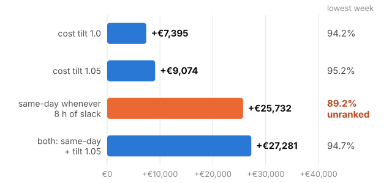
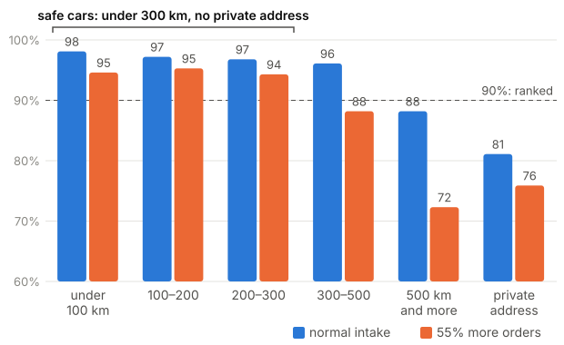
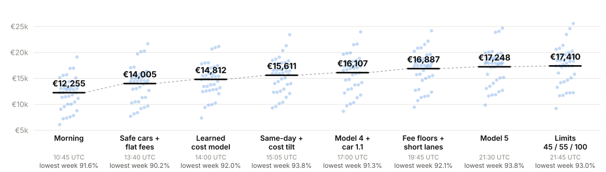
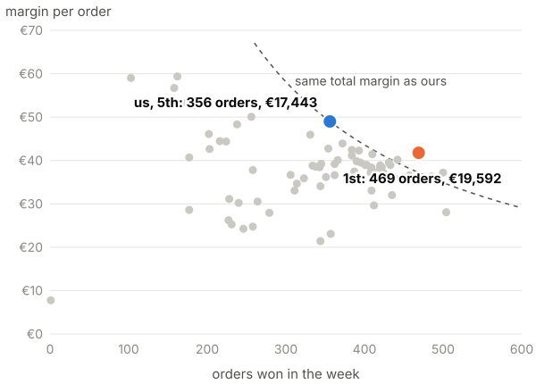
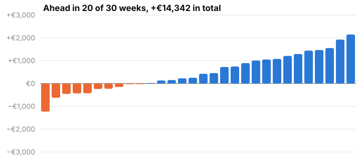

title: pelaaja juhlii · Spread dispatcher

<!--
The deck's source. Build: python3 docs/deck/build.py (see README.md).
Every number cites its source in the slide's last line. Numbers in charts come from charts.py (numbers.json).
-->

<!-- slide: title -->
::: kicker
pelaaja juhlii · Spread · Junction 2026
:::

# We price each car over its own learned cost, and take only the work our drivers can deliver

<!-- FILL IN AT ABOUT 09:40: the final's result. Replace the underscores in the one line below (the dashed tile). -->
::: tiles fill
- **Final: __ of __** €__ margin · __ orders · __% on time
:::

::: tiles small
- **13th of 56 ranked teams** (240 entered) in our best ranking round (Saturday 21:00): €84,857 over its 5 weeks, 96.4% on time
- **5th of 75 ranked** Saturday 20:00 test final: €17,443, 356 orders, 97.2% on time
- **40 of 40 ranked** weeks the final's code never saw: €17,308 and 399 orders a week, 96.1% on time
:::

::: ideas
1. **A cost model learned from 1.9 million of our own orders** says what each car will cost: its driver fee and its late risk.
2. **Each quote is the price with the most expected margin** at the price dealers accept today.
3. **Drivers learn our fees**, so a gig opens at one flat fee near what the car needs.
4. **We take more of the cars that stay on time**, and let one driver carry two or three.
5. **Every idea is a switch**, judged on the same weeks with and without it, and last on worlds no part was tuned on.
:::

::: source
Ranking round: our 5 board runs `b81-board-s9-*` in data/runs.jsonl; rank from the public board. Test final: tracks/orch/finals/testfinal-20261114-1800/README.md. Unseen weeks: `b89-main` on rob-21..60, tracks/orch/FINDINGS.md 21:50.
:::

---

::: kicker
How the system decides
:::

# A desk keeps the books; five small parts make every decision

::: formula
`quote` = the price p (in list prices) with the highest  (p × (1 − late risk) − cost) × chance(p ÷ trust)

`cost` = 1.1 × expected fee (0.85 × for a lane under 100 km) + 0.3 × (cars waiting for a driver ÷ 45)²

`chance(p)` = 1 ÷ (1 + e^((p − level) ÷ 0.2)), `level` += 0.06 × (won − chance) after each decision · `trust` = 1 + 0.01 × on-time orders to this dealer (25 at most; a late order halves it)
:::

::: source
Code: `dispatch/desk.py`, `reader.py`, `intake.py`, `pricing.py`, `learned3.py`, `bundles.py`, `fees.py`; defaults in `dispatch/policies/main.py`. Practice and the live final use the same desk.
:::

---

::: kicker
Idea 1 · What a car will cost
:::

# A model learned from our own 1.9 million orders says what each car will cost

::: cols c46
### The idea
For every request the system predicts two numbers: the driver fee the car will need (× its typical fee) and its chance of being late. Gradient-boosted trees on 44 facts known at quote time: the lane, the time, the cars, the note, our own books. Shipped as plain Python: 0.1 ms a request.

### Why
Our hand-fit cost formula expected won cars to cost 1.19 × their typical fee; from the ledger they cost 0.92 ×. So we quoted far above what dealers accepted.
+++
| Holdout worlds, never trained on | fee error (× typical) | late log loss |
|---|---:|---:|
| constant | 0.309 | 0.133 |
| hand-fit formula (model 2) | 0.274 | 0.121 |
| **learned (model 3)** | **0.232** | **0.101** |

::: effect
**+€32,271** over the same 40 weeks with the learned model (ahead in 29), 390 orders a week instead of 364; the lowest week **rose** from 90.2% to 92.0% on time.
:::

::: caveat
**Honest correction.** The last retrain (model 5) gained +€14,444 over 40 weeks, but it had trained on those worlds. On 30 worlds it never saw: **−€1,875** (ahead in 14), yet the weakest weeks rose (93.5 / 93.8 / 94.3% against 91.8 / 92.5 / 93.1%). Kept for the safer floor; since then a model is judged on unseen worlds only.
:::
:::

::: source
tracks/ml/FINDINGS.md (41,497 holdout orders, 10 worlds); docs/pricing-fix-report.md (1.19 / 0.92); `b37-fee3` vs `t3s15-safe-flat15`; model 5: `b84-fee5` vs `b68`, tracks/orch/FINDINGS.md 21:30 and 21:40.
:::

---

::: kicker
Idea 2 · Prices
:::

# Each quote is the price with the most expected margin at what dealers accept today

::: cols c46
### The idea
For each option, try prices from the car's cost upward; keep the one where margin × chance to win is highest. The chance follows one learned price level: up after every win, down after every loss. A dealer's trust in us raises the price it accepts.

### Why
In copies of whole weeks, the price at which dealers switch moved between 1.10 and 1.67 × list from day to day. One number that follows wins and losses is enough.

A request quoted both same-day and next-day is won **67%** of the time, next-day alone **34%**; an old gate dropped our same-day quote on 4,117 dev requests.
+++

::: effect
Same-day whenever 8 h of slack remain wins those requests, but alone it lost a week (89.2%, unranked). Together with a cost tilt (count the model's fee at 1.05 ×) that keeps the marginal cars out: **+€31,975 over 40 weeks**, ahead in 31, lowest week 93.8%.
:::
:::

::: source
Chart: 30 dev + rob weeks against `b37-fee3` (`b44-car100`, `b43-car105`, `b45-sameday480`, `b46-car105-sameday480`); 40-week figure: tracks/orch/FINDINGS.md 15:05. Day levels: tracks/t2/FINDINGS.md.
:::

---

::: kicker
Idea 3 · Drivers and fees
:::

# Drivers learn our fees, so a gig opens at one flat fee and rarely rises

::: cols c55
### The idea
A gig opens at the model's expected fee minus 0.15 × typical, never below 0.75 × typical (0.95 for a lane under 40 km or a car with under 5 hours left), and holds it. It rises by 0.15 at most twice: after 6 hours of the drivers' day without a booking, and a day before the last pickup. The urgent ladder waits for the deadline warning.

### Why
Drivers wait for raises they expect. When we held raises back, Friday's bookings came **306 minutes** after the driver's first view instead of **84**, at 1.18 × instead of 1.11 × the fee first seen. A fee with no raise ahead gives no reason to wait.
+++
::: tiles stack
- **86 → 7–12 min** median time from posting to booking for a one-car gig, flat fee against the hourly ladder (10 dev weeks)
- **7.0% → about 5.9%** of one-car gigs late, same comparison
- **+€69,993** over 40 weeks for flat fees together with the safe-car rule (next slide), ahead in 38 of 40
:::
:::

::: source
tracks/t3/FINDINGS.md (hold-the-ladder study `s11_viewratio.py`; flat-fee screens `t3s14`); `t3s15-safe-flat15` vs `t3s10-calm`, tracks/orch/FINDINGS.md 13:40. Code: `dispatch/fees.py`.
:::

---

::: kicker
Idea 4 · Which cars, and when we combine them
:::

# We take more of the cars that stay on time, and let one driver carry two or three

::: cols c55

We made the system win 55% more orders to see what breaks: margin fell from €127,567 to €103,440 over 10 dev weeks. Long lanes and private addresses broke; short cars stayed on time.
+++
### Safe cars
Past 45 cars waiting for a driver (55 before noon), only cars under 300 km without a private address still get a quote, up to 100.

### Bundles
A newly won car joins a gig no driver holds yet when one driver can do the stops in a row, up to 3 cars, at 0.85 × the sum of their fees.

::: effect
- Safe cars + flat fees: **+€69,993 (+14.3%)** over 40 weeks, 364 orders a week instead of 277.
- In a two-car gig a car costs **0.79 ×** typical and is **1.0%** late; alone **0.97 ×** and **3.7%**.
- Bundles on: +6.4% margin over 7 dev weeks (€74,982 against €70,496).
:::
:::

::: source
tracks/t1/FINDINGS.md (`t1s13-flood` vs `t1s11-base`, "What breaks, by group"); tracks/orch/FINDINGS.md 13:40; tracks/t3/FINDINGS.md (bundles in the 40 saved `b46` weeks); tracks/t5/FINDINGS.md (`b13-bundle2` vs `t3s5-model2`).
:::

---

::: kicker
How we know
:::

# Every idea is a switch, judged on the same 40 worlds with and without it

::: steps

:::

::: cols c333
- **Off by default.** With its switch off, the code must reproduce the mainline to the cent before a comparison counts.
+++
- **Paired weeks.** 10 dev + 20 rob + 10 holdout worlds, both versions on the same seeds. Total margin and the weakest week decide.
+++
- **Rejected for the weakest week:** earlier urgent fees made +€3,166 but put a week at 91.7%.
:::

::: source
Each dot: one week; bar: the mean; the same 40 worlds (10 dev, 20 rob, 10 holdout) at every step. Model 5 trained on dev and rob weeks, so its two steps are partly in-sample. data/runs.jsonl, labels in tracks/orch/FINDINGS.md 10:45–21:45.
:::

---

::: kicker
The test final
:::

# The live leaderboard showed our gap: about 110 short, cheap cars

::: cols c55

+++
### What we saw
We recorded the public leaderboard (every team, every 2 s) and set it against our own books. The leader's 113 extra orders brought €48 of revenue and €19 of margin each. Only one reading fits orders, revenue and cost together: about 110 cars under 100 km at the typical fee.

### Why we lost them
73% of our one-car gigs opened exactly at our 0.85 fee floor; every lane under 40 km opened at 1.15 and booked in one minute. Short cars were dear to move, so dear to quote.

::: effect
**The fix, that evening:** floors 0.75 / 0.95 and short lanes costed at 0.85 ×. **+€31,187** over 40 weeks (ahead in 34); holdout +€10,243 (9 of 10); unseen rob-21..30 +€5,993.
:::
:::

::: source
tracks/orch/finals/testfinal-20261114-1800/ANALYSIS.md (feed: leaderboard-feed.sse.gz); `b68-floor075-short095-carshort085` vs `b52-fee4-car110`, tracks/orch/FINDINGS.md 19:45 and 21:40.
:::

---

::: kicker
Robust
:::

# It holds on weeks it has never seen, and rejoins after a crash

::: cols c64

**40 unseen weeks** (rob-21..60): all ranked, mean 96.1% on time (sd 1.6 points), lowest 92.4%, €17,308 and 399 orders a week.
+++
::: tiles stack small
- **Restart** the live runner journals every action and answer, then rebuilds orders and gigs from the world and the journal. Rehearsal of the final setting, killed mid-week and restarted: €27,655, 460 orders, 93.7% on time, against €28,447, 467, 94.6% for the same world played without a restart.
- **Slow network** slowest decision batch 91 ms in that rehearsal (121 ms worst seen); slowest action round trip 564 ms; a quote has 15 world minutes, 4.5 real seconds in the final.
- **Live** the test final was played end to end by this runner: nothing undelivered.
- **Surprises** the test final had a price-war day and a 30-car bulk send from one yard: 5th of 75, 97.2% on time.
:::
:::

::: source
Chart: margin change per week, `b89-main` (the final's code) minus `b68` (19:45 mainline), rob-21..50, sorted. rob-21..60: tracks/orch/FINDINGS.md 21:50; tracks/t3/LIVE.md (`t3-live-2` vs `t3-live-ref2`, `t3-live-5`); testfinal README.
:::

---

::: kicker
Limits
:::

# What did not work, what would break it, what we don't know

::: cols c333 limits
## Did not work
- **Holding fees back:** −€65,251 over 30 weeks; unbooked gigs fill the intake.
- **Direct offers to drivers:** −€2,016; 91 of 3,783 offers accepted.
- **Cheaper quotes for volume:** each extra order cost about €75 of margin.
- **Bundles of 4 or 5 cars:** −€5,653 / −€1,915 over 30 weeks.
- **Outage detector:** −€2,732 over 30 weeks.
- **Model 5's margin gain:** in-sample only; on unseen worlds money-neutral.
+++
## Would break it
- **A late car for the biggest dealer.** In the test final one car, 3 minutes late, halved its trust count (25 → 12); we won 60% of its requests that day, 30% the next.
- **A price war day.** Our quote stops at the car's cost: we won 23% of that day's requests, 32–48% on the others.
- **A crash between the world's answer and our journal write:** the replay misses that action.
+++
## We don't know
- How the top teams move more cars per driver.
- The separate effect of the price level, dealer trust and the note reader: each was measured only together with other parts.
- How the cost model holds when the policy changes: our own books are among its inputs.
:::

::: source
docs/jury.md §5 and the tracks' FINDINGS.md files; tracks/orch/finals/testfinal-20261114-1800/ANALYSIS.md; tracks/orch/FINDINGS.md 21:40.
:::
